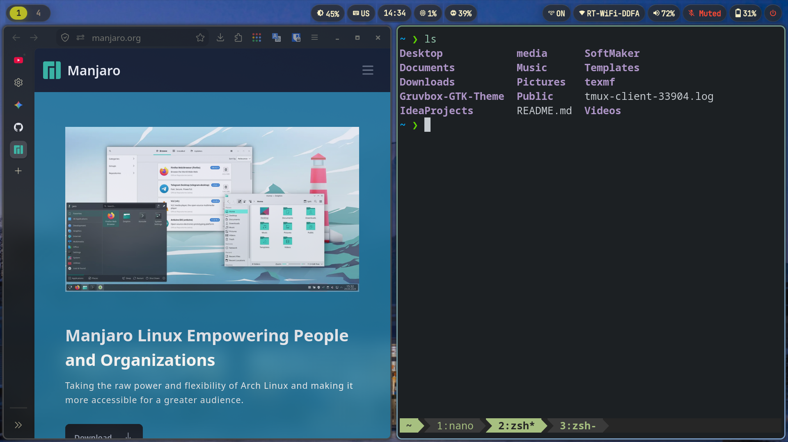
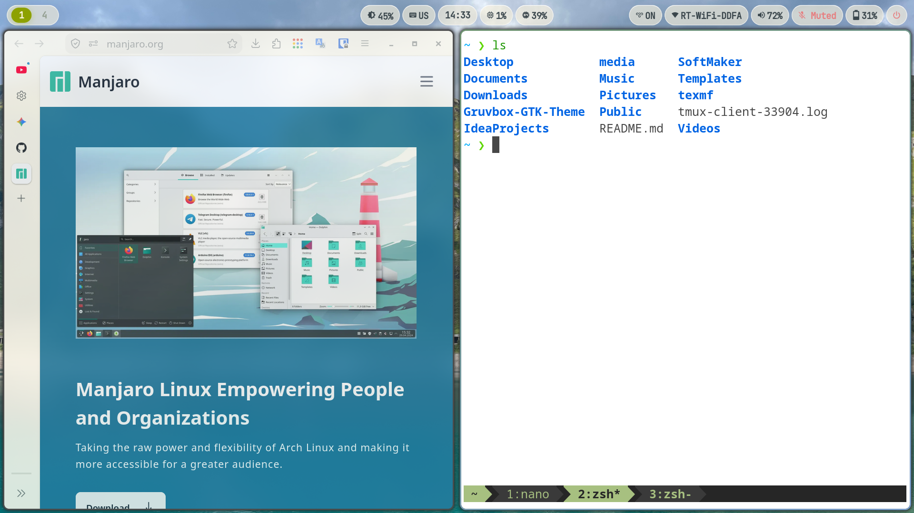

# Dotfiles

| Dark Mode (Gruvbox) | Light Mode (Everforest) |
| :---: | :---: |
|  |  |

### Stack

* **OS:** [Manjaro Linux](https://manjaro.org/)
* **WM:** [Hyprland](https://github.com/hyprwm/hyprland)
* **Bar:** [Waybar](https://github.com/alexays/waybar)
* **Terminal:** [Alacritty](https://github.com/alacritty/alacritty)
* **App Launcher:** [Rofi](https://github.com/davatorium/rofi)
* **Shell:** [Zsh](https://github.com/zsh-users/zsh)
* **Editor:** Vim + vim-plug
* **Themes:** [Everforest-B-MB-Light](https://www.gnome-look.org/p/1695467) & [Gruvbox-B-MB-Dark](https://www.gnome-look.org/p/1681313/) (download from [GNOME Look](https://www.gnome-look.org/))

Hyprland uses **`~/.config/hypr/hyprland.lua`** as its entrypoint; modular files live in `~/.config/hypr/conf/*.lua`. The old `hyprland.conf` is kept only as a reference.

### Setup

1. Install dependencies

```bash
sudo pacman -S --needed \
  hyprland waybar swaybg hyprlock hypridle \
  alacritty tmux vim zsh rofi nautilus loupe obsidian \
  polkit-kde-agent network-manager-applet brightnessctl \
  wl-clipboard papirus-icon-theme ttf-nerd-fonts-symbols \
  nwg-look git fastfetch bat swayosd socat jq swaync
```

2. Clone dotfiles

```bash
git clone --bare git@github.com:therealmaendeleo/dotfiles.git "$HOME/.cfg"
git --git-dir="$HOME/.cfg" --work-tree="$HOME" config --local status.showUntrackedFiles no
git --git-dir="$HOME/.cfg" --work-tree="$HOME" checkout

# Reload the shell or source the helpers explicitly:
. "$HOME/.config/dotfiles/helpers.sh"
```

If `checkout` complains about existing files, move them aside, run checkout again, then merge them back manually.

3. Install GTK themes

```bash
mkdir -p "$HOME/.themes"
tar -xf "$HOME/Downloads/Gruvbox-B-MB-Dark.tar.xz" -C "$HOME/.themes/"
tar -xf "$HOME/Downloads/Everforest-B-MB-Light.tar.xz" -C "$HOME/.themes/"
```

4. Enable the Alacritty auto-theme service

```bash
systemctl --user enable --now "$HOME/.config/systemd/user/AlacrittyAutoTheme.service"
```

`~/.config/systemd/user/AlacrittyAutoTheme.service` is a symlink to the canonical file in `~/.config/alacritty/alacritty-auto-theme/`. The symlink under `default.target.wants/` is generated by `systemctl` and is not tracked.

5. Install Vim plugins

```bash
vim +PlugInstall +qall
```

### Alacritty themes

The full upstream theme collection is **not** stored in this repository. Only the two colorschemes actually used are tracked:

```text
.config/alacritty/themes/themes/everforest_dark_soft.toml
.config/alacritty/themes/themes/everforest_light_soft.toml
```

`~/.config/alacritty/alacritty-auto-theme/theme.toml` is generated at login by `AlacrittyAutoTheme.service` and is intentionally ignored.

To add more colorschemes later without tracking them:

```bash
git clone --depth 1 https://github.com/alacritty/alacritty-theme /tmp/alacritty-themes
cp /tmp/alacritty-themes/themes/<name>.toml "$HOME/.config/alacritty/themes/themes/"
```

### Daily workflow

The helpers live in `~/.config/dotfiles/helpers.sh` and are sourced from both `.zshrc` and `.bashrc`:

```bash
dotstatus                         # short status
dotuntracked                      # untracked files in key config dirs
dotadd path/to/new/file           # stage a new file explicitly
dotsave "message"                 # stage tracked changes, commit, pull --rebase, push
dotsave "message" new/file        # same, plus a new file
```

`dotadd` without arguments stages only already-tracked files. Do **not** run `git add -A` with this bare repo: the work-tree is `$HOME`, so it can accidentally stage browser profiles, history files, caches, and the repo internals themselves.

### Deliberately not stored

Caches, shell/browser histories, runtime state (`current_theme_mode`, `current_wallpaper.jpg`, generated `theme.toml`, GTK settings rewritten by the theme script), plugin directories, GTK theme archives, large binaries, and Firefox profile data except `prefs.js`/`user.js`.

### Rofi

`SUPER + D` runs `~/.local/bin/rofi-menu.sh`, which picks the palette from `~/.config/hypr/current_theme_mode`:

- `light` → `.config/rofi/colors/everforest_light_soft.rasi` (matches Alacritty/Vim Everforest Light Soft);
- `dark` → `.config/rofi/colors/gruvbox.rasi` (matches the GTK/system Gruvbox dark theme).

The mode file is written by `switch-theme.sh`; if it is missing, the helper falls back to `gsettings`. Rofi reads its theme at launch, so close and reopen an already running Rofi after switching.
